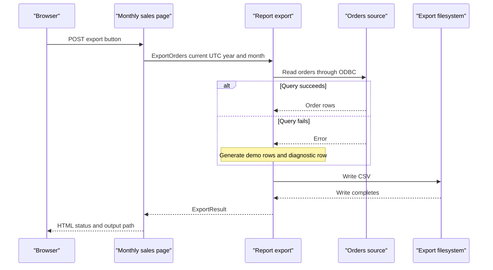

# API & Service Communication Contracts

The application exposes two browser-facing pages and one ASMX export operation. The report page invokes the export operation directly in-process; external callers can invoke the ASMX service.

## Service Catalog

| Service | Port | Category | Purpose |
|---|---|---|---|
| `Reporting.Legacy.Web` | 44330 in the README's example local URL; actual host binding is not defined in the project | API Layer / Business | Renders reporting pages and exports order data. The sole solution project references `System.Web`, `System.Web.Services`, and `System.Data`. |

`ReportExport` is a class in this project, not a separately deployed service. No container or deployment definitions are present in the repository. Sources: `Reporting.Legacy.Web.sln`, `Reporting.Legacy.Web.csproj`, `README.md`, `Services/ReportExport.asmx.cs`.

## API Endpoints Inventory

Paths are application-relative; a deployment virtual-directory prefix may apply.

| Service | Method | Path | Request Type | Response Type |
|---|---|---|---|---|
| Reporting.Legacy.Web | GET | `/Default.aspx` | Browser request | HTML landing page |
| Reporting.Legacy.Web | GET | `/Reports/MonthlySales.aspx` | Browser request | HTML report grid and message |
| Reporting.Legacy.Web | POST | `/Reports/MonthlySales.aspx` | Web Forms postback, including export button event | HTML page with export status and output path; calls `ExportOrders` in-process |
| Reporting.Legacy.Web | POST | `/Services/ReportExport.asmx` | ASMX SOAP `ExportOrders` operation with integer `year` and `month` | SOAP-serialized `ExportResult`; uncaught exceptions are not handled by application code |
| Reporting.Legacy.Web | POST | `/Services/ReportExport.asmx/ExportOrders` | `year` and `month` parameters; endpoint advertised in README | ASMX `ExportResult`; availability of the HTTP POST protocol depends on host/framework configuration |

The service declares namespace `urn:softwareone:ecom:legacy-reporting` and WS-I Basic Profile 1.1 binding. No API versioning scheme or application-specific HTTP status codes are defined in source. The repository does not establish a deployed host's ASMX protocol settings. Sources: `Default.aspx`, `Reports/MonthlySales.aspx`, `Reports/MonthlySales.aspx.cs`, `Services/ReportExport.asmx`, `Services/ReportExport.asmx.cs`, `README.md`, `Web.config`.

## Management & Observability Endpoints

| Service | Endpoint | Custom Metrics (if any) |
|---|---|---|
| Reporting.Legacy.Web | None defined in repository | None found; startup and successful exports attempt Windows Event Log entries, with logging failures ignored |

Sources: `Global.asax.cs`, `Services/ReportExport.asmx.cs`, `Web.config`.

## DTOs & Contracts

`ExportResult` is a mutable service-level response class; the operation takes two primitive integer parameters, not a request DTO. `MonthlySales.MonthlySalesRow` is a mutable presentation model bound to the report grid, not a gateway aggregation DTO. No gateway-level DTOs, OpenAPI/Swagger, protobuf, GraphQL schemas, or custom serializer configuration were found; ASMX supplies the service serialization. See `data-architecture.md` for data model details if available. Sources: `Services/ReportExport.asmx.cs`, `Reports/MonthlySales.aspx.cs`, `Reporting.Legacy.Web.csproj`, `Web.config`.

## Communication Patterns

- The pages synchronously access SQL Server via ODBC; the export button directly constructs `ReportExport` and calls it in-process. Remote ASMX calls are synchronous request/response. There is no identified message broker, asynchronous messaging, gateway, service discovery, client load balancing, or cross-service aggregation.
- Report reads fall back to demo rows on query errors or an empty result. Export query errors produce demo CSV rows and a diagnostic row instead of failing the export; file, registry and other failures outside the query catch can propagate. Event Log write failures are swallowed. There are no explicit retries, circuit breakers, timeouts, bulkheads, or downstream-service fallback policies in source.
- Windows authentication mode is configured, but authorization explicitly allows all users; there are no application role checks. Actual authentication also depends on host configuration. No HTTPS binding or TLS requirement is configured in the repository; the README's local example uses HTTP, and host-level TLS cannot be inferred. No service startup ordering is specified.

Sources: `Reports/MonthlySales.aspx.cs`, `Services/ReportExport.asmx.cs`, `Web.config`, `README.md`.

## Service Technology Matrix

| Service | Web | Data Access | Discovery | Gateway | Actuator | Cache | Metrics |
|---|---|---|---|---|---|---|---|
| Reporting.Legacy.Web | ASP.NET Web Forms and ASMX | Synchronous ADO.NET ODBC | None found | None | None found | No application cache found | None found |

Sources: `Reporting.Legacy.Web.csproj`, `Reports/MonthlySales.aspx.cs`, `Services/ReportExport.asmx.cs`, `Web.config`.

## Service Communication Sequence

