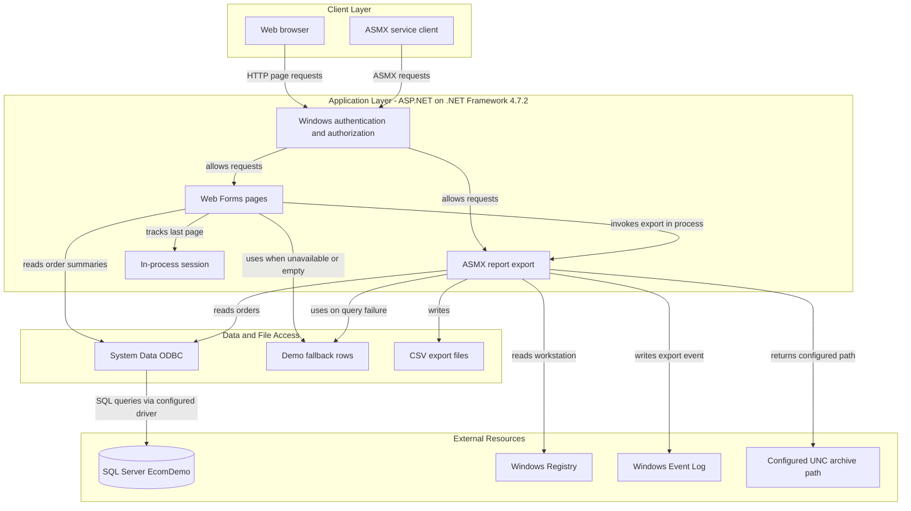
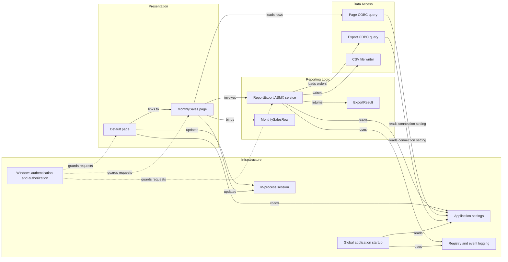

# Architecture Diagram

Reporting.Legacy.Web is a single ASP.NET Web Forms application with an ASMX export endpoint. Its reporting logic accesses SQL Server directly and falls back to demo data when the live source fails.

## Application Architecture

### Technology Stack Summary

| Layer | Technology | Version | Purpose |
|---|---|---|---|
| Presentation | ASP.NET Web Forms | .NET Framework 4.7.2 | Landing page and sales report |
| Service | ASP.NET ASMX | .NET Framework 4.7.2 | Exposes order export as a web service |
| Data access | ADO.NET ODBC | .NET Framework 4.7.2; SQL Server ODBC Driver 17 configured | Queries order data |
| Storage | SQL Server Express | Version not specified | Configured `EcomDemo` reporting database |
| Infrastructure | ASP.NET session and Windows authentication | .NET Framework 4.7.2 | In-process session and identity handling |
| Infrastructure | Windows Registry and Event Log | Version not specified | Workstation lookup and best-effort event logging |
| Storage | Local file system and configured UNC path | Not specified | CSV output and archive path metadata |

### Data Storage & External Services

The configured ODBC connection points to SQL Server Express and queries `dbo.Orders`. CSV exports are written to the configured local export root; the UNC archive root is displayed or returned as metadata, not written to by the application. Windows Registry and Event Log provide workstation metadata and best-effort logging. Session state is in-process; no external cache, message broker, or outbound API is declared in the inspected application.

### Key Architectural Decisions

- Web Forms code-behind and the ASMX service contain SQL and reporting logic directly rather than using a separate repository or service layer.
- Both reporting paths fall back to demo data on ODBC errors; the report page also falls back when no rows are returned.
- Windows authentication is configured, but authorization explicitly allows all users for the local demo; sessions are stored in process.

## Component Relationships

### Component Inventory

| Component | Layer | Type | Responsibility |
|---|---|---|---|
| Default | Presentation | Web Forms page | Shows operator, reporting mode and archive path; links to the report |
| MonthlySales | Presentation | Web Forms page | Loads and displays order summaries and triggers export |
| MonthlySalesRow | Reporting logic | Data object | Holds a customer summary row |
| ReportExport | Reporting logic | ASMX web service | Produces order CSV files and export metadata |
| ExportResult | Reporting logic | Service result | Holds export status, file path, archive root and workstation |
| Page ODBC query | Data access | Inline ADO.NET access | Queries order summaries with demo fallback |
| Export ODBC query and CSV file writer | Data access | Inline ADO.NET and file access | Queries orders and writes CSV, using demo rows on query failure |
| Global | Infrastructure | ASP.NET application lifecycle | Reads configuration and workstation information and logs startup |
| Application settings, session and security | Infrastructure | ASP.NET configuration | Supplies settings, maintains last-page session state and applies configured authentication and authorization |
| Registry and event logging | Infrastructure | Windows integration | Retrieves workstation information and writes best-effort events |

Sources: `D:\a\modernization-reporting-legacy-web\modernization-reporting-legacy-web\Reporting.Legacy.Web.csproj`, `D:\a\modernization-reporting-legacy-web\modernization-reporting-legacy-web\Web.config`, `D:\a\modernization-reporting-legacy-web\modernization-reporting-legacy-web\Default.aspx.cs`, `D:\a\modernization-reporting-legacy-web\modernization-reporting-legacy-web\Reports\MonthlySales.aspx.cs`, `D:\a\modernization-reporting-legacy-web\modernization-reporting-legacy-web\Services\ReportExport.asmx.cs`, and `D:\a\modernization-reporting-legacy-web\modernization-reporting-legacy-web\Global.asax.cs`.
