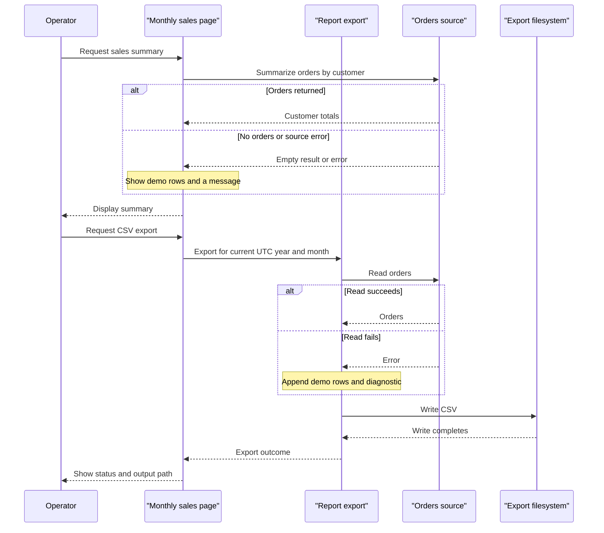

# Core Business Workflows

The application lets back-office operators view a customer-level sales summary and export order data to CSV. It can substitute demonstration data when the live reporting source is unavailable.

## Domain Entities

These are reporting concepts inferred from queries, not independently defined domain entity classes.

| Entity | Service / Bounded Context | Description | Key Relationships |
|---|---|---|---|
| Order | Reporting.Legacy.Web / order reporting | Source record used in summaries and exports | Associated with a customer identifier |
| Customer | Reporting.Legacy.Web / order reporting | Grouping identity for sales totals | One identifier can group multiple orders |
| `MonthlySalesRow` | Reporting.Legacy.Web / reporting presentation | Computed customer-level summary shown in the grid | Derived from orders for one customer identifier |
| `ExportResult` | Reporting.Legacy.Web / report export | Outcome returned to an export caller | Refers to the generated CSV and configured archive location |

Sources: `Reports/MonthlySales.aspx.cs`, `Services/ReportExport.asmx.cs`.

## Service-to-Domain Mapping

| Service | Domain Context | Owned Entities | External Dependencies |
|---|---|---|---|
| Reporting.Legacy.Web | Order reporting and export | Presentation `MonthlySalesRow` and `ExportResult`; the code reads orders but does not establish ownership of their source | ODBC orders source, export filesystem, Windows registry and Event Log; archive location is reported, not accessed |

The solution contains one project. There is no separate customer or order service, or cross-context exchange established by the repository. Sources: `Reporting.Legacy.Web.sln`, `Reports/MonthlySales.aspx.cs`, `Services/ReportExport.asmx.cs`.

## Primary Workflows

### Workflow 1: View sales summary

1. The operator opens `/Reports/MonthlySales.aspx`; on the initial request the page records the last reporting page in session and queries the orders source.
2. The query groups all orders by customer identifier and calculates order count and total sales. Despite the page title, it contains no month or year filter.
3. If reading fails, the page displays an error message and appends demo rows; an empty result also causes demo rows to be shown. If a failure happens after some rows were read, those rows remain alongside the demo rows.
4. The resulting rows are bound to the grid. A postback does not rerun this initial-load query.

Sources: `Reports/MonthlySales.aspx`, `Reports/MonthlySales.aspx.cs`.

### Workflow 2: Export orders

1. The operator clicks the export button on `/Reports/MonthlySales.aspx`; the page directly calls `ExportOrders` with the current UTC year and month. An external ASMX caller may supply those integers instead.
2. The service reads configuration and the workstation registry value, creates the output directory, and reads all orders from the ODBC source. The supplied year and month select the filename, not the queried records.
3. On an ODBC query exception, it appends demo records and an exception-type diagnostic row to any CSV data already accumulated. An empty successful query produces a header-only CSV.
4. The service writes the CSV, attempts an informational Event Log entry, and returns `ExportResult`. The page displays the status and output path. The archive root is returned as metadata; no archive copy is performed.

Sources: `Reports/MonthlySales.aspx.cs`, `Services/ReportExport.asmx.cs`.

## Cross-Service Data Flows

There are no independently deployed application services or gateway composition flows in the solution. Both workflows read the same external orders source directly through ODBC; the export additionally writes a local filesystem path. The demo-data branches described above are local source-read fallbacks, not circuit-breaker or inter-service fallbacks. Sources: `Reporting.Legacy.Web.sln`, `Reports/MonthlySales.aspx.cs`, `Services/ReportExport.asmx.cs`.

## Business Workflow Sequence

## Business Rules & Decision Logic

- **Validation:** `ExportOrders` accepts integer year and month values without explicit range or date validation. The page supplies current UTC values. No additional application-level business validators were found.
- **Calculations and selection:** summary counts and sums are grouped by customer across all stored orders; export selects all orders. Neither query filters by the requested month or year. The export filename uses those values, formatting the month with at least two digits.
- **Fallback and errors:** the summary uses demo data for errors or empty results, while export uses demo data only on exceptions. Both can retain partially read live rows before appending fallback data. Export filesystem or registry failures outside the query catch are not handled by the workflow.
- **State and integrity:** the application records the last page in session, but no order lifecycle transitions, writes to orders, uniqueness rules, or explicit transaction boundaries are implemented. The CSV write can overwrite the same year/month filename.
- **Audit and authorization:** startup and successful export attempt Event Log entries, with logging failures ignored. Windows authentication mode is configured, but authorization permits all users and no business role or resource-ownership checks are implemented.

Sources: `Default.aspx.cs`, `Reports/MonthlySales.aspx.cs`, `Services/ReportExport.asmx.cs`, `Global.asax.cs`, `Web.config`.
