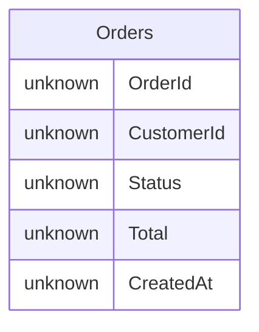

# Data Architecture & Persistence Layer

The data layer reads a SQL Server orders table through ADO.NET ODBC and writes report files; no ORM entities or repository interfaces are defined. A C# projection represents the aggregated results, while the actual database schema and relationships are not supplied.

## Database Configuration

| Service/Module | DB Type | Profile | Driver | Connection | Migration Tool |
|---|---|---|---|---|---|
| Reporting.Legacy.Web | SQL Server | Shared `Web.config`; no runtime-specific profiles found | `System.Data.Odbc` and ODBC Driver 17 for SQL Server | Local SQL Express database using Windows integrated authentication; certificate trust enabled. No explicit pooling settings. | None found; no schema, migration, or database seed scripts found. |

`Reports\MonthlySales.aspx.cs` and `Services\ReportExport.asmx.cs` open connections on demand and fall back to hard-coded demo rows on query failure; the report page also falls back on an empty result. These rows do not seed the database. See [configuration-inventory.md](configuration-inventory.md) for configuration entries.

## Data Ownership per Service

| Service | Tables Owned | ORM Framework | Caching | Notes |
|---|---|---|---|---|
| Reporting.Legacy.Web | Ownership of `dbo.Orders` is not established; it is read by this module. | None; direct ADO.NET ODBC | In-process session state; no data/query cache found | Writes local CSV exports; the configured archive path is returned as metadata, not written to by the code. |

## Entity Model

`dbo.Orders` is referenced in SQL, but its DDL, keys, SQL types, constraints, and relationships are not present. The diagram shows only observed query columns, without asserting a primary key or relationships.

`Reports\MonthlySales.aspx.cs` defines `MonthlySalesRow` as a read-only query projection in usage, with `CustomerId` (`string`), `OrderCount` (`int`), and `TotalSales` (`decimal`); it is not an ORM entity. `Services\ReportExport.asmx.cs` defines `ExportResult` as a response object rather than a persistent entity. No ORM relationships or explicit transaction management were found.

> Note: Some entities or relationships could not be fully identified because the database schema is not included.

## Key Repository Methods

| Service | Repository | Notable Methods | Purpose |
|---|---|---|---|
| Reporting.Legacy.Web | None; `Reports\MonthlySales.aspx.cs` | `LoadRows(): IEnumerable<MonthlySalesRow>` | Executes raw SQL grouping `dbo.Orders` by `CustomerId`, counting orders and summing `Total`. |
| Reporting.Legacy.Web | None; `Services\ReportExport.asmx.cs` | `BuildCsv(int year, int month): string` | Reads the five observed `dbo.Orders` columns with raw SQL and builds CSV. The SQL has no date filter; arguments do not limit rows. |

No stored procedure, repository interface, bulk aggregation across services, or database write was found.

## Caching Strategy

No application data cache, cache provider, query cache, TTL, or eviction configuration was found. ASP.NET in-process session state stores `LastReportingPage` for 60 minutes; it is session state, not a shared database cache (`Web.config`, `Default.aspx.cs`, `Reports\MonthlySales.aspx.cs`). The code does not state a cache rationale.

## Data Ownership Boundaries

One module directly queries a configured SQL Server database; whether other applications share or own it cannot be determined from this repository. It also writes CSV files to a configured local directory. No inter-service data access or CQRS implementation is evidenced; observed database access is read-only, with separate filesystem output.

### Data Classification & Sensitivity

| Entity | Sensitive Fields | Classification (PII/PHI/PCI/None) | Controls in Place |
|---|---|---|---|
| `dbo.Orders` and exported CSV | `CustomerId` may identify a customer; identifiers and order totals may be commercially sensitive. Actual identifier semantics are unknown. | Potential PII; no PHI or PCI fields observed | Integrated database authentication is configured; no field-level encryption, masking, or field-level access controls are defined in this repository. Database and filesystem encryption at rest cannot be determined from source. Export files contain order data. |

