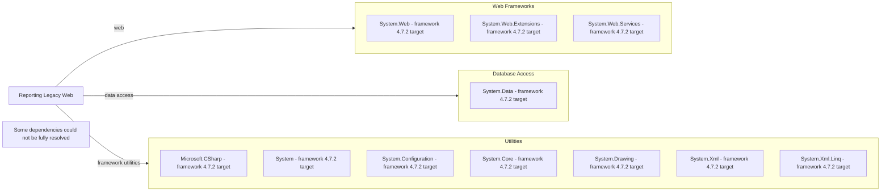

# Dependency Map

Reporting.Legacy.Web declares 11 non-test framework assembly references and no NuGet packages in its project and package files. These are direct references; individual assembly versions are not declared and the project targets .NET Framework 4.7.2.

## Dependencies

### Dependency Summary

| Category | Count | Key Libraries | Notes |
|---|---:|---|---|
| Web Frameworks | 3 | System.Web, System.Web.Extensions, System.Web.Services | Framework references for the legacy ASP.NET stack |
| Database Access | 1 | System.Data | Framework data access assembly |
| Utilities | 7 | Microsoft.CSharp, System, System.Configuration, System.Core, System.Drawing, System.Xml, System.Xml.Linq | General framework assemblies, including configuration and XML |

### Version & Compatibility Risks

The project targets .NET Framework 4.7.2 and relies on `System.Web` and ASMX, which are not part of modern .NET's ASP.NET Core platform and require application changes for a move to modern .NET. Project references do not specify individual assembly versions; the framework target above is not a claim about their assembly version numbers. The project imports classic Visual Studio web application targets when available, which also affects build portability.

### Notable Observations

- `packages.config` is empty: no direct NuGet package versions or package transitive dependencies are declared there.
- All 11 references are framework assemblies used in the project build; no separately declared messaging, cache, logging, observability or security package was found.
- Framework references have no separate test scope; no test project or test-scoped package is declared in the solution and package files.

## Test Dependencies

| Framework | Version | Notes |
|---|---|---|
| None detected | — | No test-scoped dependencies declared |

Total test-scope dependencies: 0

No test dependencies detected. No test infrastructure is declared in the inspected build and package files.

Sources: `D:\a\modernization-reporting-legacy-web\modernization-reporting-legacy-web\Reporting.Legacy.Web.csproj`, `D:\a\modernization-reporting-legacy-web\modernization-reporting-legacy-web\Reporting.Legacy.Web.sln`, and `D:\a\modernization-reporting-legacy-web\modernization-reporting-legacy-web\packages.config`.
